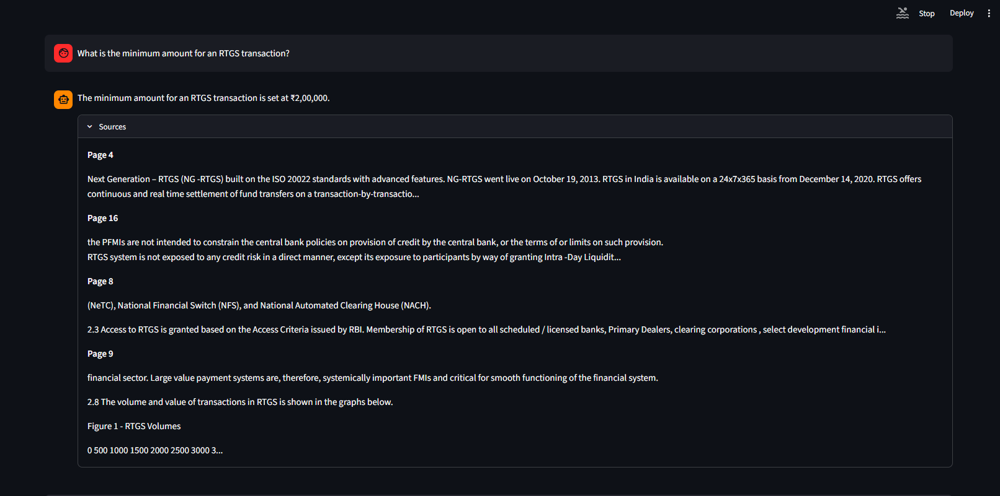
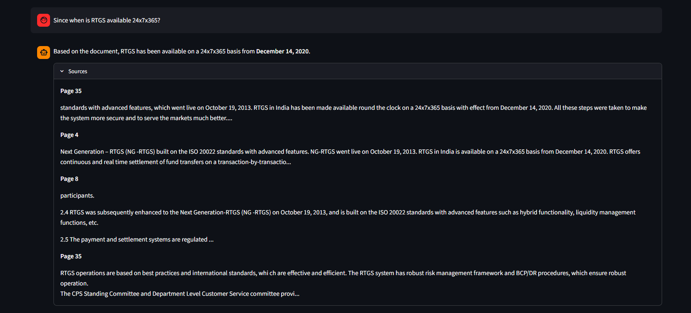
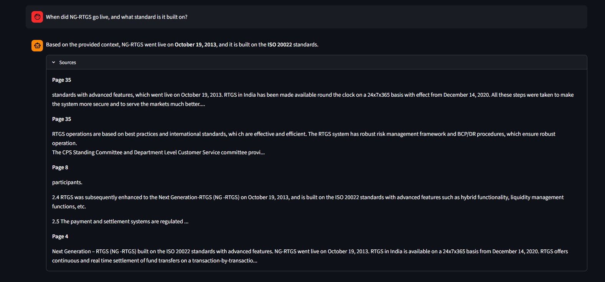
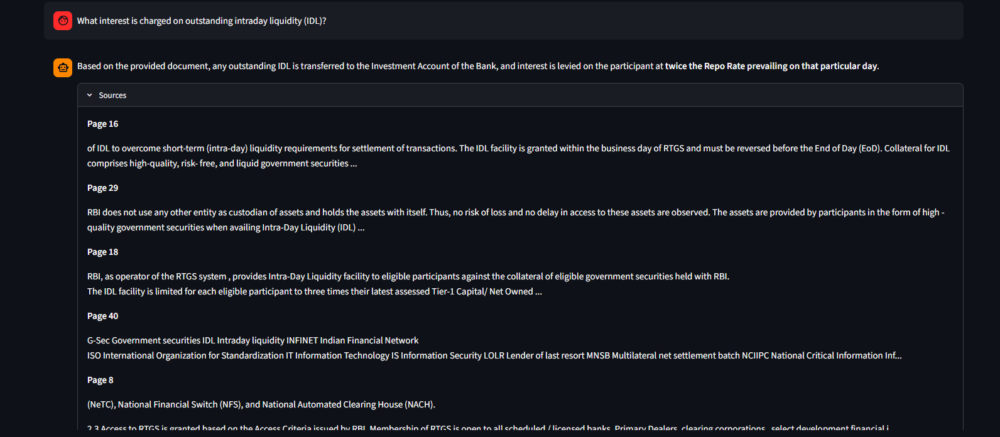
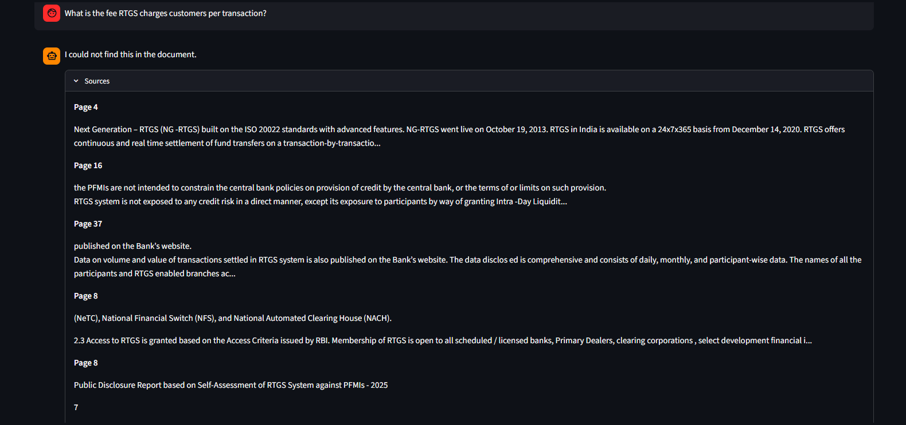
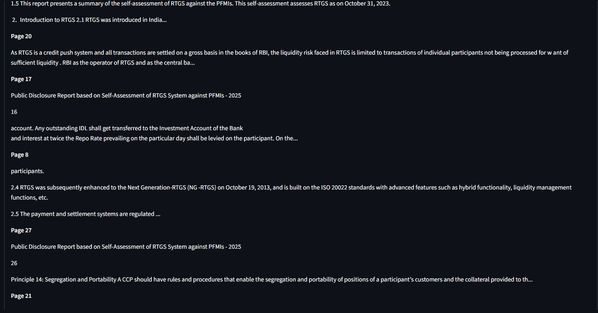

# Document Q&A Chatbot using RAG

A chatbot that answers questions from an uploaded PDF (for example bank FAQs, tariff schedules or regulatory reports) and shows the source pages for every answer. If the information is not in the document, it says so instead of guessing.

Built with Retrieval-Augmented Generation (RAG): the app retrieves the most relevant parts of the PDF first, and the LLM answers using only those parts.

## Demo

Tested on the RBI RTGS Public Disclosure Report (42 pages).

**Q: What is the minimum amount for an RTGS transaction?**



**Q: Since when is RTGS available 24x7x365?**



**Q: When did NG-RTGS go live, and what standard is it built on?**



**Q: What interest is charged on outstanding intraday liquidity (IDL)?**

The answer sits in a passage that says only "IDL", so hybrid retrieval (semantic plus keyword) is needed to find it.



**Q: What fee does RTGS charge customers per transaction?** (not in the document)

The bot refuses instead of guessing:





## Features
- Upload any text-based PDF and ask questions in a chat interface
- Answers grounded only in the document, with the source pages and passages shown
- Refuses to answer when the document does not contain the information
- Hybrid retrieval: semantic search (embeddings) plus keyword search (BM25)
- Free local embeddings, so only the final answer uses the Gemini API

## Tech stack
Python, Streamlit, LangChain, Sentence-Transformers (all-MiniLM-L6-v2), FAISS, BM25 (rank_bm25), pypdf, Google Gemini API

## How it works
1. Extract text from each PDF page (pypdf)
2. Split the text into overlapping chunks (800 characters, 100 overlap)
3. Embed the chunks and store them in a FAISS vector index
4. For each question, run hybrid retrieval: semantic search (top 4) and BM25 keyword search (top 4), then merge and remove duplicates
5. Send the retrieved chunks and the question to Gemini with a prompt that says "answer only from the context"
6. Show the answer and the source pages (PDF page numbers)

### Why hybrid retrieval?
Pure semantic search missed an answer when the question and the document used different words. The question said "intraday liquidity", but the answer passage only said "outstanding IDL". Adding BM25 keyword search next to the embeddings fixed it, because keyword search catches exact terms and abbreviations that embeddings can rank poorly.

## Project structure
```
rag-pdf-chatbot/
├── app.py            # Streamlit user interface
├── rag.py            # PDF loading, chunking, retrieval and answering logic
├── requirements.txt  # Python dependencies
├── images/           # Screenshots used in this README
└── .gitignore        # Keeps .env, venv and PDFs out of git
```

## Run locally
1. Clone the repo and create a virtual environment:
   ```
   python -m venv venv
   venv\Scripts\activate
   ```
2. Install the dependencies:
   ```
   pip install -r requirements.txt
   ```
3. Get a free API key from Google AI Studio and create a `.env` file in the project folder:
   ```
   GOOGLE_API_KEY=your_key_here
   GEMINI_MODEL=gemini-3.6-flash
   ```
4. Start the app:
   ```
   python -m streamlit run app.py
   ```
5. Upload a PDF in the browser and start asking questions. The first start is slow because the embedding model is loaded once.

## Limitations
- Text PDFs only (no OCR for scanned documents)
- Table-heavy PDFs can be extracted out of order, so values may be matched to the wrong row
- Questions like "summarize the whole document" work poorly, because only a few chunks are retrieved per question
- The index is kept in memory and rebuilt for each upload

## Possible improvements
- Layout-aware extraction for tables
- Cross-encoder re-ranking of the retrieved chunks
- Persistent vector store and support for multiple documents
- Evaluation set to measure answer accuracy automatically